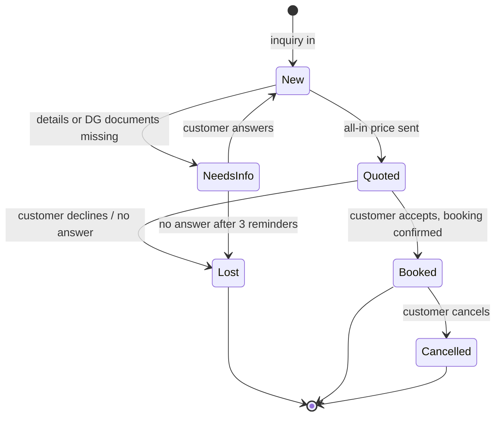

# CRM: UX review and rebuild plan

Status: **built** (2026-11-22, see section 7 and ADR 58). Code: `crm/` at the top of the repo, its own server independent of the router: `crm/desk.py` (data), `crm/app.py` (read-only endpoints), `crm/ui/` (pages), tests in `crm/tests/test_crm.py`; start with `bash crm/crm.sh`.

Goal (user): a person who works in the shipping industry opens the CRM, sees at a glance where things stand, knows what they can do, and finds their way without an explanation. No duplicate functions. Modelled on large CRMs (HubSpot, Salesforce, Pipedrive) and freight systems (CargoWise, Magaya, Freightos/WebCargo).

---

## 1. Review: what is wrong today

Based on every page in the running CRM (Now, Sessions, Performance, Rounds, Lookup with 5 tabs, Ultra, System, shipment and account pages).

### Critical

| # | Finding | Where | Why it hurts |
|---|---|---|---|
| K1 | **Two data worlds.** Now, Sessions, Rounds, Performance and Lookup show the router database, which stopped on 21 Nov 23:31 (last mail 24,253). The live system is ultra-talos (mail 55,621), and only "Ultra" shows it. Above all of it the header says **"Live · updated 09:57"**. | all | The person sees old figures labelled as live. Trust is gone after the first look. |
| K2 | **Contradictory status.** The status bar says "Read-only view" and in red **"SENDING ON"** at the same time, and System says "Sending and booking" with the poller off. | status bar, System | Nobody can tell whether the system is working right now. |
| K3 | **Buttons that do not work.** On Now, "Retry booking", "Send reminder" and "Close" are greyed out; why is only in a tooltip. Only "Dismiss" works. | Now | "What can I do?" is answered with "nothing", without saying so. |

### Major

| # | Finding | Where |
|---|---|---|
| H1 | **One request shown four ways:** Sessions (chat timeline), Rounds (table row), shipment page ("What happened"), Ultra (event timeline). Each has a different status vocabulary: *Accepted / Declined / Waiting for customer / No quote* vs. *Open / Quoted / Booked / Cancelled*. | Sessions, Rounds, Shipment, Ultra |
| H2 | **Hackathon and developer words instead of industry words:** Rounds, Ledger, Sessions, Lookup, legacy, classification confidence 99 %, "Prompt: talos-extract-rfq", Dry run. A forwarder thinks in **inquiry, quote, booking, AWB, ETD/ETA, customer, carrier, rate**. | everywhere |
| H3 | **Carriers in two places:** airlines and truckers under Performance *and* under Lookup. Mail in three: Lookup/Mail, the correspondence on the account page, the session timeline. | Performance, Lookup, Account |
| H4 | **The home page is half globe.** The globe is a picture, not a decision; it pushes the queue into half the width. | Now |
| H5 | **Times in minutes:** "waiting 823 min" instead of "13 h"; IDs instead of names (#24011). | Now, Lookup |
| H6 | **No pipeline.** Every CRM shows where deals stand (columns by stage). Here the status is spread over Now, Rounds and Ultra. | — |

### Minor

- The Live/Dry-run switch is in the header on every page, but it is a developer function.
- The search box appears and disappears depending on the page; there is no global search (for a customer, BK number or mail ID).
- The table filters on Rounds (All / Accepted / Declined …) look like tabs but are filters; real tabs (Ledger / Quote mails) look the same.
- Performance has no conclusion (no conversion, no win rate, no trend); it is lists.
- The Ultra page is a foreign object: its own status words, its own KPIs, no link to customer or carrier.

---

## 2. Benchmark: what the big systems have in common

| System | Home | Core object | Pipeline | Contacts | Partners | Reports | Admin |
|---|---|---|---|---|---|---|---|
| HubSpot | Tasks + KPIs | Deal | board by stage | Contacts / Companies | — | Dashboards | Settings (gear) |
| Salesforce | Home (to-dos, KPIs) | Opportunity | Kanban/list | Accounts | — | Reports | Setup |
| Pipedrive | Activities | Deal | Kanban by default | People / Orgs | — | Insights | Settings |
| CargoWise / Magaya | Work queue | **Shipment / Quote** | status list with milestones | Organizations | **Carriers** | Reports | System |
| Freightos WebCargo | Dashboard | Quote / Booking | status list | Customers | Airlines | Analytics | Account |

Patterns we adopt:
1. **Home = "what is waiting for me"**, a few KPIs, nothing decorative.
2. **One core object with one detail page.** For us: the **shipment** (inquiry → quote → booking → delivery).
3. **The pipeline is a view on the core object** (board or list), not a separate page.
4. **Master data** (customers, carriers, rates) each get one menu item.
5. **Reports** are separate from operations.
6. **Admin/setup** sits apart (gear icon at the bottom), not in the work menu.
7. **Global search** in the header finds everything (customer, BK number, mail, airport).

---

## 3. Target structure

### Navigation: 6 items + settings

```mermaid
flowchart LR
  subgraph Work["Work"]
    T[Today]
    S[Shipments]
  end
  subgraph Master["Master data"]
    C[Customers]
    K[Carriers]
    R[Rates]
  end
  subgraph Analysis
    B[Reports]
  end
  G[Settings ⚙]

  T -->|click a task| SD[Shipment page]
  S -->|click a row/card| SD
  C --> CD[Customer page] --> SD
  K --> KD[Carrier page] --> SD
  SD --> CD
  SD --> KD
```



| New | Question it answers | Replaces |
|---|---|---|
| **Today** | What do I have to do now? Is the system running? | Now (without the globe), the NEEDS_HUMAN line of Ultra |
| **Shipments** | Where does each request stand? | Rounds/Ledger, Sessions, Ultra list, Lookup/Mail (mail is in the shipment) |
| **Customers** | Who are my customers, what do they ask for, how do they decide? | Lookup/Accounts, account page |
| **Carriers** | Which airline/trucker is fast, cheap, reliable? | Lookup/Airlines + Truckers, Performance tables |
| **Rates** | Which rate applies to a lane? | Lookup/Tariffs |
| **Reports** | Are we getting better? Why do we lose? | Performance, "Why rounds were lost", Quote mails tab |
| **Settings ⚙** | Where does the data come from, how fresh is it? | System, status-bar detail, Live/Dry-run switch |

**Removed as menu items:** Now, Sessions, Rounds, Lookup, Performance, Ultra, System (their content moves, nothing is lost).
**Removed entirely:** the Live/Dry-run switch, requests from the desk's dry-run period, every operator action (Retry booking, Send reminder, Close, Dismiss). **Kept (user):** the globe on Today and per shipment, and the colour strips above the Today tiles.

### One status for each shipment

The same words everywhere (list, board, detail, customer page, report):



| Status | Colour | Meaning for the person |
|---|---|---|
| New | grey | the desk is working on it |
| Needs info | yellow | we are waiting for the customer |
| Quoted | blue | the price is with the customer |
| Booked | green | booked, BK number known |
| Lost / Cancelled | grey, crossed out | with the customer's reason |
| **⚠ Needs you** | red (badge, not a status) | the system is stuck: booking failed, CAPTCHA, desk crashed |

"Needs you" is an extra marker on top of the status, not a status of its own, so a shipment never changes its status just because a person is needed.

---

## 4. Pages in detail

### 4.1 Today (home page)

```
┌──────────────────────────────────────────────────────────────────────┐
│ ● Desk running · last mail 2 min ago               🔍 Search  ⚙     │
├──────────────────────────────────────────────────────────────────────┤
│  New today 12   Quoted 9   Booked 6   Lost 2   Win rate 75 %        │
├──────────────────────────────────────────────────────────────────────┤
│ NEEDS YOU (2)                                                        │
│ ⚠ CAPTCHA on the rate portal · shipment 35811 · 13 h                │
│ ⚠ Booking failed · Hofmann Textilwerk · FRA→LOS · 2 h               │
├──────────────────────────────────────────────────────────────────────┤
│ WAITING FOR CUSTOMER (3)                                             │
│   Nordlicht Audio · DG documents missing · since 13 h                │
├──────────────────────────────────────────────────────────────────────┤
│ RUNNING NOW                                                          │
│   ⟳ Rheintal Elektronik · STR→TLV · desk writing the quote           │
└──────────────────────────────────────────────────────────────────────┘
```

- **Three blocks, in order of urgency:** Needs you → Waiting for customer → Running now. Each line: customer, lane, what, for how long (h/min, not "823 min"). The whole line opens the shipment; there are no buttons.
- KPI row: today, 5 numbers, each clickable → Shipments filtered accordingly.
- One status line at the top instead of the tick strips: *running / stopped since … / error*. The strips move to Settings.

### 4.2 Shipments (pipeline)

- **Two views of the same list, switchable:** a **table** (default; sortable, search, filter by status/customer/airline/lane) and a **board** (columns New · Needs info · Quoted · Booked · In transit · Closed, cards with customer, lane, price, age). Columns: New · Needs info · Quoted · Booked · Closed.
- Columns: Shipment · Status · Customer · Lane (FRA → LOS) · Price all-in · Airline · BK number · Last activity.
- Saved filters as chips: *Mine to do*, *Open*, *Booked this week*, *Lost*.

### 4.3 Shipment page (the one detail page)

```
┌──────────────────────────────────────────────────────────────────────┐
│ ← Shipments   Shipment 55129 · Nordlicht Audio      ● Booked BK-ILUW │
│ HAM → YYZ · 11 pcs · 1,898 kg (2,562 kg chargeable) · ready 5 Dec    │
├───────────────────────────────────────────┬──────────────────────────┤
│ TIMELINE (live)                           │ PRICE                    │
│ 09:21 ✉ Inquiry from Nordlicht Audio      │ All-in   8,724.96 EUR    │
│ 09:22 ⚙ 5 truckers asked                  │ Air      8,299.57 Borealis│
│ 09:24 ⚙ Choice: Maintal 425.39 EUR, 14 h  │ Truck      425.39 Maintal │
│ 09:25 ✉ Quote sent (show mail)            │ CARGO                    │
│ 09:28 ✉ Customer accepts                  │ pieces, weight, DG, …    │
│ 09:29 ✔ Booked BK-ILUWABM8                │ OFFERS                   │
│ 09:29 ✉ Confirmation sent                 │ airlines / truckers      │
│                                           │ NOTES (desk)             │
└───────────────────────────────────────────┴──────────────────────────┘
```

- **Timeline = what Sessions, "What happened" and the Ultra timeline do today, merged.** Mails fold open in place. New events appear live (SSE as today).
- Right-hand column: price, cargo, offers, the desk's notes. Small map optional, folded.
- **Mail has no menu item of its own:** every mail belongs to a shipment. Mails without a shipment (spam, look-alike addresses) appear on Today when they need something, otherwise in global search.

### 4.4 Customers / customer page
List: name · contact · shipments · win rate · revenue (booked) · last activity. Page: KPIs, their shipments (same table as 4.2, filtered), what they usually ask for (lanes, priority, DG).

### 4.5 Carriers / carrier page
Tabs **Airlines | Truckers**. Per carrier: how often priced, how often chosen, average price/kg, transit, **reply rate and reply time** (truckers), bookings. Page: their shipments. The performance tables move here; they are not shown twice.

### 4.6 Rates
The tariff table with a lane filter (from, to, airline), as today.

### 4.7 Reports
One page, four cards with a sentence as the conclusion:
1. **Funnel:** inquiries → quoted → accepted → booked (this week / total).
2. **Why we lose:** reasons in the customer's words, grouped (too expensive, too cheap, PDF missing, DG not asked).
3. **Speed:** time to quote, time to booking (median, trend).
4. **Quote quality:** the style-rule checks of the quote mails (today the "Quote mails" tab).

### 4.8 Settings ⚙
Where each figure comes from (files, counts, newest entry), the desk's cursor (last mail read), sessions running now. Read-only.

### Header on every page
Logo · **global search** (customer, shipment number, BK number, mail ID, airport) · status dot (green/yellow/red, click → Settings) · light/dark · notification bell. Nothing else.

---

## 5. Data: ultra-talos as it is, read-only

**Decision (user):** ultra-talos is not changed any more. The CRM reads only what ultra-talos already writes, and writes nothing. The router database is no longer shown.

| What the CRM needs | Source (existing file) | How exact |
|---|---|---|
| Every inbound mail with category, sender role and shipment | `ultra-talos/mails/<id>.json` (all 1,300 mails since 21 Nov 15:00) | exact |
| Every outbound mail (id, to, subject, body, time) | `logs/*.jsonl`: the platform's answer to each sent mail; the log file names the inbound mail, so the shipment | exact; a carrier's reply (`in_reply_to`) joins the same shipment |
| Bookings: BK number, airline, air price, status | `logs/*.jsonl`: the platform's answer to `POST /v1/portal/bookings` (`team_reference` = shipment) | exact |
| Desk working now | `board.db` `session_start` without `session_end`; older than 30 min counts as stale | exact |
| Needs a person | `state/NEEDS_HUMAN`, `needs_human` events, a desk session that ended with an error | exact |
| Accepted / declined | the classification of the customer's mail (`customer_accept`, `customer_reject`); the reason is the customer's own reply | exact |
| Customer name and lane | the first line of `shipments/<id>/notes.md` (`# Shipment 55129: Nordlicht Audio, HAM -> YYZ`) | the desk's own header; 86 of 135 files follow it, otherwise only the address |
| Quoted all-in price | the `QUOTE SENT … EUR all-in` line in `notes.md` | the desk's notes, shown as "from the desk notes"; never read from mail text |
| Carriers, zones, rates | `ultra-talos/data/*.csv` | exact |

**Statuses that cannot be read from this data** are left out: *In transit* and *Delivered* (no flight dates in structured form). The pipeline therefore ends at **Booked**, and **Closed** collects Lost and Cancelled.

Not used: the platform board (`GET /v1/board/me`, its rounds cannot be matched to shipments without changing ultra-talos), the dry-run `outbox/`.

## 6. Implementation steps

| Step | Content | Result |
|---|---|---|
| 0 | Approve this plan; open questions (section 7) | decisions → `decisions.md` (ADR 58) |
| 1 | **Data:** one read layer `crm/desk.py` that turns the ultra-talos files (section 5) into shipments, customers, carriers. Tests against small fixture files. | one source, one status vocabulary |
| 2 | **Frame:** new navigation, header with global search and status dot, Settings page; remove Live/Dry-run from the header | the person finds their way |
| 3 | **Shipments + shipment page** (table, board, timeline with live stream) | replaces Rounds, Sessions, Ultra, Lookup/Mail |
| 4 | **Today** (three blocks, read-only; a line opens its shipment) | replaces Now |
| 5 | **Customers, Carriers, Rates** | replaces Lookup, Performance tables |
| 6 | **Reports** | replaces Performance, loss reasons, Quote mails |
| 7 | Delete old pages and endpoints, adapt the tests, independent UX read "as a forwarder" (review as in ADR 57) | no duplicates left |

Each step ends with a running CRM (screenshots for review), never in a half state.

---

## 7. Decisions (user, 2026-11-22)

1. **Data source:** ultra-talos only, from its existing files; ultra-talos itself is not changed (section 5). The router data is no longer shown, there is no "demo data" switch.
2. **No buttons that trigger anything.** The CRM is read-only: no Done, no Dismiss, no retry. A line can only open a page.
3. **Language:** English.
4. **Shipments:** table by default, board as a switch.
