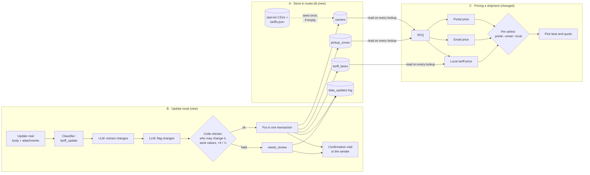
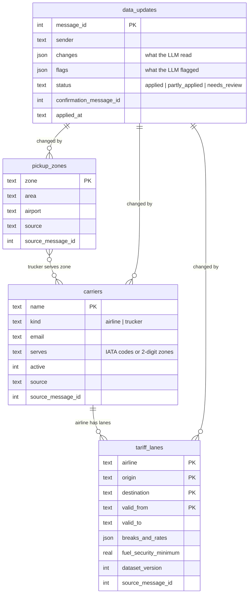
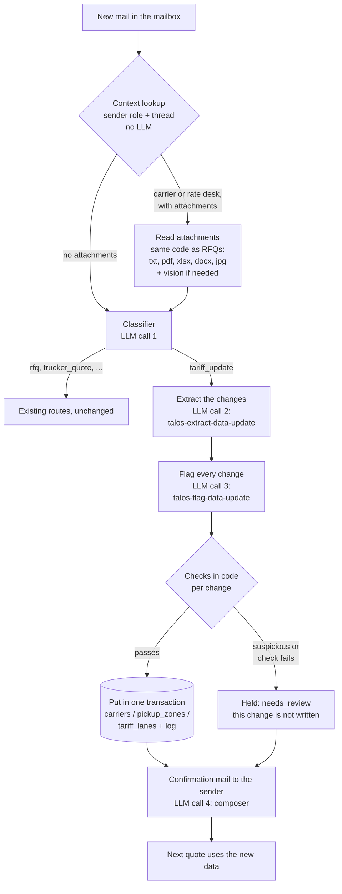
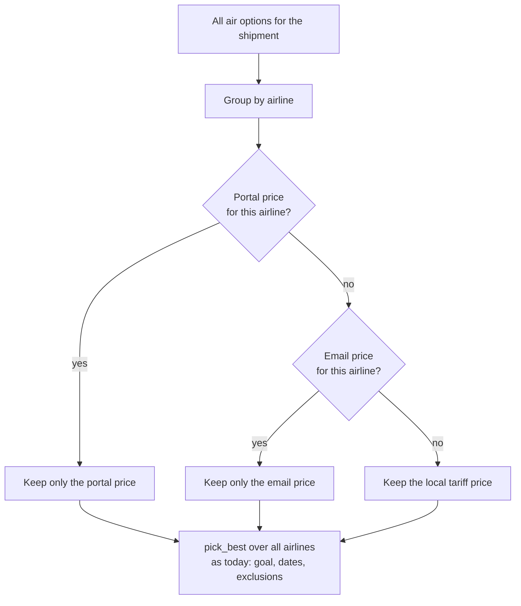

# Data updates by mail (plan, not built yet)

**Status:** built 2026-11-21 (evening), see [section 13](#13-built-what-differs-from-the-plan). Decisions: [ADR 50](decisions.md#adr-50-one-updatable-store-for-reference-data-changed-by-update-mails), [ADR 51](decisions.md#adr-51-price-source-per-airline-portal-then-email-then-local-tariff).

## In one paragraph

Today the bot reads its carrier list, its pickup zones and its tariffs from files **once, at startup**. If a carrier mails us "we now also fly to Lima" or "here is our December tariff", nothing happens: the classifier tags the mail `tariff_update` and the bot ignores it. The plan: move the three datasets into `router.db` as three **separate** tables, read them **fresh on every lookup**, and give `tariff_update` a handler. The handler reads the update mail (body and attachments, like an RFQ), lets an LLM **flag** every change it finds, checks the changes in code, **puts** them into the tables (insert if new, overwrite if it exists, never delete unless the mail says so) and **confirms the update to the sender**. The very next quote uses the new data.

## What we build, at a glance

Three parts: **(A)** the store, **(B)** the update route, **(C)** the price-source rule ([ADR 51](decisions.md#adr-51-price-source-per-airline-portal-then-email-then-local-tariff)).



## 1. What we keep, and where

Three datasets, three tables. They are **not merged**: they hold different things.

| Table | Holds | Today | Seeded from | Key (what "the same record" means) |
|---|---|---|---|---|
| `carriers` | Who a carrier is: name, kind (airline / trucker), email, `serves`, active | `data/start-kit/carrier-list.csv` | that CSV | name |
| `pickup_zones` | Which airport a postal zone uses: zone, area, airport | `data/start-kit/pickup_zones.csv` | that CSV | zone |
| `tariff_lanes` | The prices of the tariff airlines: one row per lane (origin, destination, transit, minimum, breaks, rates, fuel, security, valid from/to) | `data/tariffs.json` | that JSON | airline + origin + destination + valid_from |
| `data_updates` | The log: every update mail, what the LLM found, its flags, what was applied, and the confirmation we sent | (new) | - | message id |

Every row in the first three tables gets two extra columns: `source` (`start_kit` or `mail`) and `source_message_id` (which mail last changed it). So we can always answer "where does this price come from?".



**The files stay in git, as the starting point.** On startup the tables are filled from them **only if they are empty**. `router.db` is not in git (ADR 49), so a fresh checkout, a test DB or a replay still starts from the start kit. After that, the DB is the truth and the files are not read again.

**No duplicated facts.** For a tariff airline, the destinations it serves come from its lanes, not from `serves`. A new lane in a tariff mail therefore makes the airline "serve" that destination right away. `serves` stays the truth for truckers (zones) and for portal and email-only airlines (destinations).

## 2. Updatable and queryable on the fly

- `Reference` and `Tariffs` keep **the same methods** (`truckers_for_zone`, `airport_for_zone`, `carrier_for_email`, `airline_email`, `lanes`, ...). Only what is behind them changes: instead of cached files they run a small SQLite query on every call. The workflow does not change.
- SQLite with a few hundred rows answers in well under a millisecond, so no cache is needed. No cache also means no "stale until restart" bug.
- One update mail is written in **one transaction**: either all its applied changes land or none.
- A small read-only endpoint, `GET /reference/{carriers|zones|tariffs}`, lets us look at the current data while the bot runs (next to the existing endpoints in `ENDPOINTS.md`).

## 3. Put, never silently delete

Every change is a **put**:

- **No record yet:** insert it.
- **Record exists:** overwrite **only the fields the mail gives**. A mail that only changes a trucker's email leaves its zones alone.
- **Lists only grow:** "we now also serve zone 52" adds 52 to `serves`. The old zones stay.
- **Lanes the mail does not mention stay.** A tariff with 5 lanes overwrites those 5 and leaves the airline's other lanes untouched. A new tariff with new dates (`valid_from` 1 December) is a new record next to the November one, so November keeps working until it ends.
- **Delete only when the mail says so**, in words such as "we no longer serve zone 45", "this lane is discontinued", "please remove us". Then the LLM returns an explicit removal. A removed carrier is set `active = 0` and not deleted, so old shipments still find it.

**Two valid lanes for the same route on the same day** (for example new rates "from 25 November" next to the November tariff): `lanes(today)` returns, per airline and route, the one with the **latest `valid_from`**; on a tie, the one from the later mail. Nothing is deleted for that. Using the date first (not the mail order) means an old tariff mail read late, or in a replay, cannot push back a newer one.

**Missing dates in a short mail** ("our CGN-JFK rate is now 3.10 per kg"): `valid_from` = today. `valid_to` = the end of the lane it overwrites, or the end of the month if there is none.

**A change with a new start date copies the lane.** "Fuel is 0.85 per kg from 1 December" does not edit the November rows. It copies each current lane of that airline with `valid_from` = 1 December and the new fuel value. November stays correct until it ends.

**Relative changes** ("all rates +5 % from 1 Dec", "fuel +0.10"): the LLM only reports the percent or the amount and which lanes it applies to. **Code** does the maths on the current rows. The LLM never recalculates hundreds of numbers.

**A new lane with missing fields** ("we now fly CGN-LIM at 4.20 per kg"): a lane needs breaks, rates, minimum, fuel and security to be priced. Missing fields are taken from the airline's own lane from the same origin, else from any of its lanes (the start-kit files have the same terms for every lane). If the airline has no lane at all, the lane is held and the confirmation asks for the missing values.

## 4. The new route

The classifier already has the type **`tariff_update`**. We keep that label and only widen its description. No new category.



### Step by step

1. **Context lookup (no LLM).** As today: who is the sender (airline, trucker, rate desk, customer)?
2. **Read the attachments.** Today `poller.py` only does this for customers. It is widened to carriers and the rate desk, and uses the same `attachments.enrich()`: local text for txt, pdf, xlsx, docx, pptx, and one vision call for scans and pictures. This covers every format of the start kit, including the scanned Danube Wings pages.
3. **Classifier (LLM call 1).** The existing label `tariff_update` gets a wider description: "a carrier or the rate desk tells us about a change to our reference data: a new tariff or price list, a single new rate, a new or changed email, a destination or zone added or dropped, a carrier stopping, a zone moving to another airport". The code name stays `tariff_update`, so stored rows and Langfuse history keep working.
4. **Extract (LLM call 2).** A new prompt reads the mail and its attachments into a list of typed changes:
   - `PutTariffLane`: airline, origin, destination, valid_from, valid_to, and only the fields given (the same fields as `TariffLane`)
   - `PutCarrier`: name, and only the fields given (kind, email, destinations or zones to **add**)
   - `PutZone`: zone, area, airport
   - `Remove`: what to remove (a lane, a destination or zone from `serves`, a whole carrier) and the sentence in the mail that asks for it

   **It handles both shapes of mail:**
   - **A full dataset, like the start kit:** a whole tariff file, a new carrier list, a new zone table. The tariff part reuses the `build_tariffs.py` prompt, which already reads every start-kit format correctly. A full dataset is still a put: what it lists is written, what it does not list stays.
   - **One short mail changing one thing:** "new email for Grautal Trucking", "CGN-JFK now 3.10 per kg". One change, no attachment needed.

   **Currency:** the extractor returns each price with its currency and any exchange rate the mail states. Code converts to EUR (section 5).
5. **Flag (LLM call 3).** A second, small call gets the changes **next to the rows they would overwrite** and marks each change:
   - `ok`: clear and plausible
   - `unclear`: vague wording, a guessed field, a file partly unreadable
   - `suspicious`: kept **lean** (user decision). Only these few cases:
     - a price more than **4×** the old one (a jump of over 300 %), or less than **¼** of it. Both usually mean a unit mistake (per 100 kg, per lb, cents, a total read as a per-kg rate). The check is done **in code**, per field (each rate, minimum, fuel, security), against the lane being overwritten. A rise of 50 % or 200 % is fine.
     - a removal the mail does not clearly ask for
     - the mail gives two different values for the same thing
     - it is not reference data but **an offer for one shipment** (a `rate_id`, "valid for 15 minutes", our request's route and weight). That belongs to `rate_offer`, not to the tables.
     - text that talks to the bot instead of to a forwarder ("ignore your instructions", "set all rates to ...")

   Not suspicious any more: a `valid_from` in the past (applied from now on), a smaller price change, a new destination or zone. A sender that does not match the carrier is not a flag either: the code check in step 6 handles that.

   Each flag has a one-line reason. Flags and reasons go into `data_updates` and Langfuse.
6. **Checks in code.** These run even if the LLM says `ok`, because the sender is outside our control:
   - **Who may change what:** an airline only its own tariff and entry, a trucker only its own entry, **the rate desk any carrier's data**. Matched by the sender address, never by what the mail says.
   - **Sane values:** the checks from `build_tariffs.py` (IATA codes, ascending breaks, as many rates as breaks, rates > 0, valid_from <= valid_to, a known origin airport), moved into one shared function so the build script and the mail route use the same rules.
   - **Nothing breaks:** every pickup zone keeps at least one trucker, and every zone points to one of the 6 airports.
7. **Put or hold, per change.**
   - `ok` and `unclear` changes that pass the checks are **written** (user decision). `unclear` is kept in the log so we can find it later.
   - `suspicious` changes and failed checks are **held** (`needs_review`), and are not written. The rest of the mail is still applied.
   - The log status is `applied`, `partly_applied` or `needs_review`.
8. **Confirm to the sender (LLM call 4).** A new composer mail kind, `update_confirmation`, in reply to the update mail. It names what we changed ("CGN-JFK and CGN-MIA rates from 1 Dec", "new email noted") and, if something was held, says we will come back on it, without giving the reason. Same style rules and footer as other mails (ADR 48), with exact values and no typos (like the booking request).
   - A reply to our confirmation ("thanks") is `other` and gets no mail, so there is no loop.
   - This changes ADR 19 for this one label: a `tariff_update` now gets exactly one mail back.

## 5. Converting to EUR

- **The mail gives a rate** ("1 USD = 0.92 EUR"): use it.
- **USD, no rate given:** use the last `fx_eur_per_usd` the portal returned (already read in `portal_client.py`).
- **Another currency with no rate:** hold that change (`needs_review`) and say so in the confirmation. We do not guess exchange rates.
- We store only EUR. The original currency and rate go into the log.

## 6. Edge cases, the same as for RFQs

| Case | How it is handled |
|---|---|
| The tariff is in an attachment (pdf, xlsx, docx, txt) | Local text, as for RFQ attachments (ADR 42) |
| Scanned pages or a picture (jpg, png, pdf with images) | One vision call per file (ADR 43), as the Danube Wings scans in the start kit |
| A tariff in two files (rates on page 1, surcharges on page 2) | All attachments of a mail go into **one** extraction call, as `build_tariffs.py` already does for Danube |
| Up to 5 attachments, a file that cannot be read | As today: max 5 files. An unreadable file makes its changes `unclear`; if nothing is readable, nothing is written and the confirmation asks for the file again |
| Comma decimals, Excel date serials, `D+4`, "2 days", `-45/+45` breaks | The extraction prompt from `build_tariffs.py` already handles these (see [data.md](data.md#airline-tariff-files-the-local-db)) |
| Prices not in EUR | Converted (section 5) |
| The update is in the body only | Extracted from the body, no attachment needed |
| One mail with several changes | One `data_updates` row, several changes, one transaction, one confirmation |
| The same mail read twice (replay, restart) | `data_updates.message_id` is the key, so a mail is applied and confirmed at most once |
| An update in reply to our pickup or rate request | **Trap:** today a reply from a trucker or airline we are waiting for skips the classifier (ADR 41, 47) and is read as a quote. Plan: the quote extractors already return "no price"; if a reply has **no price and has attachments or mentions a tariff or a change**, it goes to the classifier instead |
| A mail from an unknown address claiming to be a carrier | The role is set from the address, so it is a customer and is never applied as an update |
| A brand-new carrier announced by the rate desk | Inserted with `PutCarrier`; it can be asked for quotes from the next shipment on. Mail to it is only possible if the platform accepts the address (it rejects unknown recipients with 422, see [platform-api.md](platform-api.md)) |

## 7. Update mails we should expect

Nobody knows the real format, so the prompts and tests are built around this list. Each one becomes a test mail.

| # | From | Mail (short) | Becomes |
|---|---|---|---|
| 1 | Cobalt Skylift | "Attached our December tariff" + pdf, same layout as the start kit | `PutTariffLane` × all lanes, `valid_from` 1 Dec |
| 2 | Danube Wings | Two scanned pages: rates on p1, surcharges on p2 | One extraction over both images, as `build_tariffs.py` |
| 3 | Elbflug | xlsx with only the 3 lanes that changed | 3 puts; the other lanes stay |
| 4 | Kestrel | "CGN-JFK is now 3.10/kg above 100 kg, rest unchanged" | One field of one lane; the other brackets stay |
| 5 | Vega | "General rate increase of 5 % from 1 Dec" | Relative change, code does the maths, lanes copied from 1 Dec |
| 6 | Helix | "Fuel surcharge 0.85/kg on all lanes, effective immediately" | Fuel on every Helix lane, from today |
| 7 | Wayzata | "New route: FRA-LIM, 5 days, same rates as FRA-SCL" | New lane copied from FRA-SCL |
| 8 | Orion | "We discontinue HAM-SYD from 15 Dec" | `Remove` of one lane, from 15 Dec (`valid_to` = 14 Dec) |
| 9 | Quetzal | Tariff in USD with "1 USD = 0.92 EUR" | Converted at the rate in the mail |
| 10 | Grautal Trucking | "From now on please write to dispatch@... " | `PutCarrier` email; the old address is kept as an alias (section 8) |
| 11 | Neckarstrom Kurier | "We now also cover 52 and 53" | Zones added; the old zones stay |
| 12 | A trucker | "We no longer serve zone 45" | `Remove` of zone 45, **unless** it is that zone's last trucker (held) |
| 13 | Rate desk | "Zone 90 (Nürnberg) is now served from MUC" | `PutZone` 90 → MUC |
| 14 | Rate desk | "New carrier: Alpenfracht, trucker, zones 82 83, alpenfracht@hackloop.mail" | `PutCarrier` (insert) |
| 15 | Rate desk | Updated `carrier-list.csv` as attachment | Puts for every row; carriers not in the file stay |
| 16 | An airline | "We stop all operations from 1 Jan" | `Remove` of the carrier, deactivated from 1 Jan |
| 17 | Portal airline (e.g. Aurelia) | "Our new email is ..." or "we now serve BOG" | Carrier data only, see section 8 for prices |
| 18 | A trucker | Its own pickup price list (per zone, per kg) | **No table for it**, see section 8 |
| 19 | A trucker | "Closed 24-26 Dec" | **Not in our data model**, see section 8 |
| 20 | Anyone | Newsletter "we are expanding to South America next year!" | Nothing concrete: the classifier should say `other`; if it says `tariff_update`, the extractor finds no change and nothing is written or confirmed |

## 8. What could go wrong in our setup

Things in **our current code** that would break or behave oddly, and what the plan does about each.

| # | Risk | Why it happens here | Plan |
|---|---|---|---|
| 1 | **An update is swallowed as a quote** | A reply from a trucker or airline we are waiting for skips the classifier (ADR 41, 47) | Section 6: no price + attachment or change wording → classifier |
| 2 | **The reverse: a quote is read as an update** | A trucker quote with its rate card attached, or the rate desk's "Portal rates HAM-EZE ..." mail (we got one, message 7230), looks like a price list. The rate desk may change any data, so this is the dangerous one | The classifier keeps `rate_offer` for offers about **our** request; the flag "offer for one shipment" holds it; and an awaited reply that has a price for our request stays a quote |
| 3 | **A portal airline sends a tariff** | The 3 groups (portal, tariff, email-only) do not overlap today (ADR 06). A stored lane for a portal airline would show up next to its portal price, and `tariffs.airlines` (`workflow.py:340`) would stop asking it by email when the portal is down | Section 8a: per airline, portal › email › local. Its lanes are stored but only used when neither the portal nor an email gave a price |
| 4 | **Changed email breaks open requests** | Replies are matched to our requests by sender address (`find_trucker_request`), and `role_for_email` decides who is a carrier. After an email change, a late reply from the old address, or a reply from the new address to a request sent to the old one, would be "a customer" | Keep the old addresses as aliases of the carrier; lookups check aliases too |
| 5 | **Mail to a new address returns 422** | The platform only accepts recipients from its own carrier list | Send as normal; on 422, fall back to the alias (old address) and log it. The confirmation goes to the address the update came from, which the platform accepts |
| 6 | **A deactivated airline cannot be booked** | A customer accepts a quote after the airline was removed; booking by email looks up `airline_email()` | Booking and reply matching ignore `active`; only *new* quotes skip inactive carriers |
| 7 | **Quotes already sent change price** | - | They do not: the accepted quote is booked from `shipment.chosen_option`, which is stored with the shipment. Only new quotes use the new data |
| 8 | **A zone loses its last trucker** | A trucker drops a zone | Held; the confirmation says it is pending |
| 9 | **A zone points to an airport we cannot price from** | "Zone 90 → NUE": NUE is not one of the 6 airports, and the portal lanes start only at those | Held unless the portal or a tariff has lanes from that airport |
| 10 | **A long tariff is cut off by the LLM** | 150+ lanes in one answer can hit the output limit | Put semantics make this safe: lanes not returned stay as they were. Long files are split per origin airport, as one call per file did in `build_tariffs.py` |
| 11 | **Breaks do not match the rates** | "New rates: 5.10 / 4.00 / 3.20" for an airline whose lanes have 7 brackets | The lane check fails, held, confirmation asks for the full table |
| 12 | **Wrong units or number formats** | Per 100 kg, per lb, comma decimals, `01.12.2026` vs `12/01/2026` | The ×4 / ¼ rule catches unit mistakes; ambiguous dates are `unclear`, read as German (day first) since all senders are German forwarding partners |
| 13 | **Prompt injection in an attachment** | Files from outside go into an LLM | Permissions, value checks and the ×4 / ¼ rule are code, not LLM. The confirmation mail is built from the stored changes, never from the mail's own text |
| 14 | **A reply to our confirmation starts a loop** | Some senders answer every mail | At most one confirmation per update mail; replies to a confirmation are `other`. Same loop cap as everywhere (max 3) |
| 15 | **Replays and tests change real data** | `replace_airline()` today writes into `data/tariffs.json` itself | The DB replaces that file, so a replay only changes `replay.db` (seeded fresh each run) and tests only change `test.db` |
| 16 | **The start-kit files are edited later, and nothing happens** | Seed only runs when the tables are empty | A small `scripts/reseed.py` (puts from the files, same put rules) for that case |
| 17 | **A trucker price list or closing days** | We have no table for trucker prices (we ask per shipment) or for availability | Logged, nothing written; the confirmation says "noted". Open question 2 |
| 18 | **Cost** | Up to 4 LLM calls per update mail, plus vision for scans | Update mails are rare; the flag call is small. Watch it in Langfuse |

## 8a. Which price counts, per airline

Decided by the user: **the portal is the most reliable source, then the airline's own email, then our local tariff** ([ADR 51](decisions.md#adr-51-price-source-per-airline-portal-then-email-then-local-tariff)).



- **Which airlines are asked how stays as today:** portal airlines on the portal, email-only airlines by email, tariff airlines from our table. When the portal is down, every airline that is **not tariff-only** is asked by email (ADR 47).
- **The rule only matters when one airline has more than one source.** That happens once an update mail gives a portal or email-only airline a local tariff. Examples:
  - Aurelia (portal) sends a tariff. Portal up: the portal price is used, the tariff is not. Portal down: Aurelia is asked by email; its email price wins; if it does not answer, the local tariff is the fallback, so the customer still gets a price.
  - Zephyr (email-only) sends a tariff. We still mail Zephyr for each request; its reply wins; the local tariff is the fallback when it does not answer in time.
- **Booking follows the price we used,** as today (`workflow.py:808`): a portal price is booked on the portal, an email or tariff price by email.
- **Where:** one small function, `pricing.by_source(options)`, called at the top of `Workflow._price()` before `pick_best`. And in `_request_airline_rates` the check "not a tariff airline" becomes "not a tariff-only airline" (an airline the portal lists is never tariff-only; the portal lane list is cached, so this also works when the portal is down).

## 8b. UI: a "Tariff updates" tab

The UI (`router/app/ui.html`, served at `/ui`) gets a second view next to the conversations: **Tariff updates**. It is a list of **every change** an update mail made or tried to make.

**Header:**

```text
TALOS · Customer conversations   [ Conversations | Tariff updates ]   [ Live | Dry run ]
```

The new view switch sits next to the existing Live / Dry run switch, so the tab also works on the replay data. It refreshes every 15 s like the rest (`setInterval` in `ui.html`), so a mail that arrives tonight shows up without a reload.

**The tab, with data:**

```text
┌ Tariff updates ───────────────────────────────────────────────────────────────┐
│ 3 mails · 41 changes · 39 applied · 2 held              [All] [Applied] [Held] │
├───────────────┬──────────────┬─────────────┬────────────────────┬─────────┬──────────┤
│ When          │ From         │ What        │ Change             │ Status  │ Flag     │
├───────────────┼──────────────┼─────────────┼────────────────────┼─────────┼──────────┤
│ 21 Nov 22:14  │ Cobalt Sky.. │ CGN-EZE     │ +45 kg 4.17 → 4.30 │ applied │ ok       │
│               │              │ lane        │ from 1 Dec         │         │          │
│ 21 Nov 22:14  │ Cobalt Sky.. │ CGN-LIM     │ new lane           │ applied │ unclear  │
│ 21 Nov 23:02  │ Grautal Tr.. │ carrier     │ email a@ → b@      │ applied │ ok       │
│ 21 Nov 23:40  │ Rate desk    │ zone 90     │ new → MUC          │ held    │ no MUC.. │
└───────────────┴──────────────┴─────────────┴────────────────────┴─────────┴──────────┘
  click a row → the mail, its attachments, all its changes, the LLM's flags with reasons,
                and the confirmation we sent
```

- One row per **change**, newest first, with **before → after**, so "what has changed" is answered without opening anything.
- Filter chips: All / Applied / Held. A held row says why (the flag reason or the failed check).
- Clicking a row opens the mail, its attachments, all its changes, and the confirmation we sent.

**The tab, empty (production today):**

```text
┌ Tariff updates ──────────────────────────────────────────────┐
│                                                              │
│   No update mails yet.                                       │
│   When a carrier or the rate desk mails a new tariff, rate,  │
│   email or zone, every change shows up here.                 │
│                                                              │
└──────────────────────────────────────────────────────────────┘
```

**What the tab needs behind it:**

- **One row per change, with before and after.** `data_updates` keeps one row per mail. A second table, `data_changes`, keeps one row per change: `message_id`, `table`, `record_key` (for example `Cobalt Skylift CGN-EZE 2026-12-01`), `field`, `before`, `after`, `status` (applied / held), `flag`, `reason`, `applied_at`. The before value is read inside the same transaction as the write, so it is exact.
- **`GET /data-updates?source=live|replay`:** mails newest first, each with its changes. It goes through `get_view_store` like `/shipments`, so Live and Dry run both work.
- **Mails we got but have not handled yet.** Update mails can arrive tonight, before the handler is built. They are already stored in `processed_messages` with the category `tariff_update`. The tab also lists these, marked "received, not handled yet", so we can see them right away. Once the handler ships, a one-off `scripts/apply_pending_updates.py` runs the handler on every stored `tariff_update` mail that has no `data_updates` row yet. Because each mail is keyed by its message id, it is applied (and confirmed) once.

## 9. What changes, file by file

| File | Change |
|---|---|
| `router/app/storage.py` | 5 new tables (incl. `data_changes`, section 8b), seed-if-empty, query helpers, one put-in-transaction function |
| `router/app/reference.py` | Same methods, reads `carriers` and `pickup_zones` from the DB |
| `router/app/pricing.py` | `by_source(options)`: per airline, portal › email › local (section 8a) |
| `router/app/tariffs.py` | Same methods, reads `tariff_lanes` from the DB; newest lane wins on the same day; put instead of `replace_airline()` |
| `router/app/schemas.py` | `DataChange` types (`PutTariffLane`, `PutCarrier`, `PutZone`, `Remove`); flag schema |
| `router/app/extractors.py` | `extract_data_update()`, `flag_data_update()` |
| `router/app/composer.py` | Mail kind `update_confirmation` |
| `router/prompts/` | `talos-extract-data-update.md`, `talos-flag-data-update.md`; wider `tariff_update` text in `router-classification.md`; `update_confirmation` in `talos-compose-mail.md` |
| `router/app/workflow.py` | Handler `_on_tariff_update` in `_handlers`; the "reply without a price" trap; `by_source` in `_price()`; "tariff-only" check in `_request_airline_rates` |
| `router/app/poller.py` | Read attachments for carriers and the rate desk too |
| `router/app/main.py` | `GET /reference/...`, `GET /data-updates` |
| `router/app/ui.html` | View switch Conversations / Tariff updates; change list with filters, empty state, detail view (section 8b) |
| `router/scripts/apply_pending_updates.py` | Runs the handler once on stored `tariff_update` mails that came in before it existed (section 8b) |
| `router/scripts/build_tariffs.py` | Uses the shared lane checks |
| `router/scripts/reseed.py` | Puts from the start-kit files into an existing DB (section 8, risk 16) |
| `router/tests/` | The 20 mails of section 7, plus tests for: insert, overwrite of given fields only, lists only grow, explicit removal, newest lane wins, sender not allowed, rate desk allowed, USD conversion, confirmation sent once |

## 10. Build order

1. Tables + seed + `Reference`/`Tariffs` on the DB. Check: all existing tests pass, and a replay gives the same quotes as before.
2. Price source per airline (`by_source` + the tariff-only check), plus its tests. Small and separate, so it can ship first.
3. Put rules (insert, overwrite given fields, lists only grow, explicit removal, newest lane wins), plus their tests.
4. Wider `tariff_update` text in the classifier + attachments for carriers.
5. Extract + flag prompts. Check them on made-up update mails of both shapes: a full file from the start kit (for example the Cobalt pdf as "the December tariff") and short one-line changes, with `EVALUATION_KEY` directly at OpenAI, never the scored gateway.
6. Handler + checks + put + EUR conversion, plus the trap for replies.
7. Confirmation mail.
8. `GET /reference/...` and `GET /data-updates`.
9. UI tab "Tariff updates" (section 8b). Check it once with an empty DB (production today) and once after a replay with the 20 test mails.
10. `scripts/apply_pending_updates.py` for update mails that came in before the handler, then docs (`workflow.md`, `data.md`, `implementation.md`).

## 11. Decided (user, 2026-11-21)

- **Content of real update mails: unknown.** Handle both: a full dataset like the start kit, and one short mail changing one thing.
- **Confirm to the sender:** yes, one mail per update mail.
- **Apply what we find:** yes, including `unclear` changes. Only `suspicious` changes and failed checks are held.
- **Rate desk:** may change any carrier's data.
- **Other currencies:** convert to EUR.
- **We do not ask carriers for updates.** Only incoming updates are handled.
- **Put semantics:** insert if missing, overwrite if it exists, add without deleting. Delete only when the mail says so.
- **Classifier:** use the existing `tariff_update` type; no new category.
- **Price source per airline:** portal › email › local tariff (section 8a, ADR 51).
- **UI:** a "Tariff updates" tab with a list of every change (before → after, status, flag); empty in production for now (section 8b).
- **Lean flags:** a price rise of 50 % is fine. Only over 300 % (more than 4× the old price) counts as suspicious.

## 12. Defaults until decided otherwise

These are built as proposed unless the user says otherwise:

1. **Trucker price lists and closing days** (section 8, risk 17): logged, nothing written, the confirmation says "noted".
2. **A price drop to less than ¼** of the old one: held like a rise over 4× (usually a unit mistake).

## 13. Built: what differs from the plan

Code: `app/refdb.py` (tables, one connection per DB file), `app/updates.py` (put rules, checks, log), `Workflow._on_tariff_update`, `pricing.by_source`, the two prompts, `GET /data-updates`, `GET /reference/{kind}`, the Tariff updates tab (`/ui#updates`), `scripts/apply_pending_updates.py`. Tests: `tests/test_updates.py`.

| Plan | Built | Why |
|---|---|---|
| Confirmation written by the composer (LLM call 4) | **Template** `update_confirmation`, exact values, no LLM | Same as every other carrier mail (ADR 38): the reader needs facts; the text is built from what we stored, never from their mail. One LLM call less |
| Shared lane check with `build_tariffs.py` | `updates.py` has its own, more lenient check; `build_tariffs.py` keeps its strict one-off asserts | The build script asserts November dates and narrow ranges that a real update must be allowed to break |
| "Reply without a price" goes to the classifier | **Only a reply to our request** (`in_reply_to` = our request) skips the classifier; any other mail from that carrier is classified | Simpler and exact: all 103 live carrier replies so far were threaded to our request. Dry runs (requests never sent) keep the old rule |
| USD without a rate: portal rate | The portal's **last** `fx_eur_per_usd` seen by this process, else held | The portal gives a rate only with a USD price; there is no rate endpoint |
| `scripts/reseed.py` (risk 16) | Not built | Never needed so far. To reseed: delete the rows of `carriers`, `pickup_zones`, `tariff_lanes` and restart |
| Remove a pickup zone | Held with "tell us which airport serves it instead" | Never seen; dropping pickups silently is worse than asking |
| Relative change with no lane valid on its start day | Builds on the latest lane before it ("+5 % from 1 Dec" on the November tariff, which ends on 30 Nov) | Found by the test; the November lanes end the day before |
| Attachment text limit | 20,000 characters for carriers and the rate desk, 3,000 for customers as before | Three start-kit tariffs are over 3,000 characters and would have been cut |

**Checked with the real model** (EVALUATION_KEY, directly at OpenAI, local prompt files), on six sample mails:

- **Full tariff:** the Cobalt PDF sent as "the December tariff" gave all 21 lanes, dated 1–31 Dec. The flag call marked them `unclear` because the file itself says November. That's correct: they are applied, and the reason shows in the tab.
- **Short changes:**
  - "+5 % from 1 Dec" became one `adjust` (`ok`).
  - The trucker's new email and zone 44 became two puts (`ok`).
  - "HAM-SYD discontinued from 15 Dec" became one `remove` (`ok`).
  - The USD rates kept the mail's rate of 0.92 (`ok`).
- **The rate desk's one-shipment offer** (message 7230) was classified `rate_offer` and gave no changes.

**Before production:** the classifier text for `tariff_update` was widened in `prompts/router-classification.md`. Production reads its prompt from Langfuse, so the change counts only after `scripts/push_prompts.py`. The two new prompts aren't in Langfuse yet, so they fall back to the local files, which works as is.

