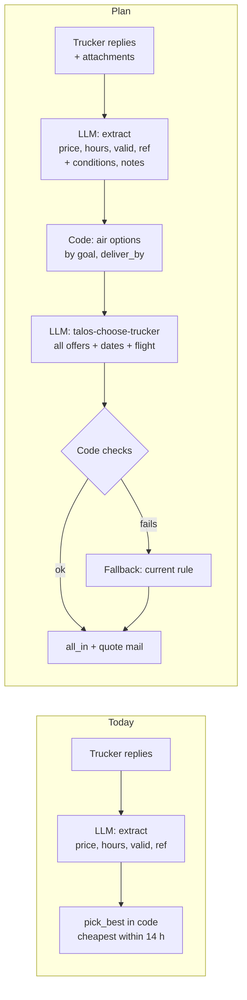
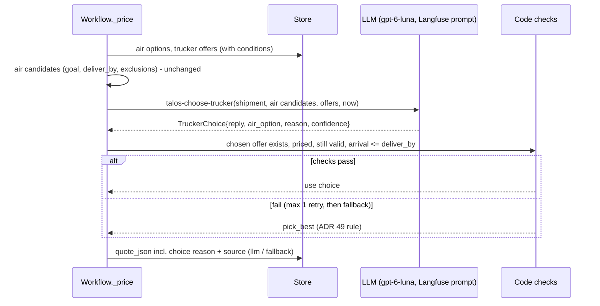

# Trucker choice by LLM (plan, not built yet)

**Status:** built 2026-11-21 as [ADR 55](decisions.md#adr-55-an-llm-can-choose-the-trucker-off-until-it-beats-the-rule). The eval gate failed (LLM 673.6 vs rule 736.0 accuracy points on 18 rounds), so it ships switched off (`TRUCKER_CHOOSER=rule`).

## In one paragraph

Today code picks the trucker with a fixed rule (cheapest within 14 h, ADR 49). The rule only sees three numbers per offer (price, pickup hours, validity), and it is wrong whenever the real deadline differs, e.g. round 68 (shipment 18954), quoted too high and rejected. Trucker replies come in every format (mail, PDF, Word, Excel, image, voice) and may carry facts the rule never sees (waiting-time charges, "only Monday to Friday", "pickup only from 08:00", a surcharge, a lead time counted from the order). The plan: **(1)** extract *everything* a trucker says, not just three fields; **(2)** let one LLM call, `talos-choose-trucker`, choose the trucker from all offers with the shipment's dates and the chosen flight; **(3)** check the answer in code, fall back to the current rule if the check fails; **(4)** run the same code path in production and in an offline replay of past rounds, which is the gate before it goes live.

## What changes, at a glance

## Where it sits in the quote flow

## Parts

### 1. Extract everything a trucker says

- `TruckerQuote` (`app/schemas.py`) gets `conditions: list[str]`. The LLM lists every limit or extra in the trucker's own words: pickup windows, weekdays, waiting time, surcharges, "from order to collection", the chargeable weight they used, anything new.
- The `talos-extract-trucker-quotes` prompt is told to fill it and never to drop a fact. Stored in `trucker_requests.conditions_json`.
- New edge cases need no code change: an unknown fact lands in `conditions`, and the chooser reads it.

### 2. `talos-choose-trucker` (new prompt, Langfuse)

- **Input (JSON facts, no raw mail):** goal, ready date, deliver_by, now (= our order time), pickup and departure airport, the air candidates (airline, total, transit days, estimated departure/arrival), and per offer: reply id, price, pickup hours, valid until, conditions.
- **Rule given to the model, in order:**
  1. The goods must reach the departure airport in time for the chosen flight on its departure day.
  2. Of those that make it: cheapest for goal "cheapest" or none; earliest arrival for goal "fastest", price breaks ties.
  3. Respect every condition (weekday, window, surcharge counts towards the price).
  4. If none makes it, choose the one that makes the earliest flight and say so.
- **Output:** `TruckerChoice{reply: int, air_airline: str, reason: str, confidence: float, concerns: list[str]}`. The reason is stored and visible in the CRM `/shipments` detail.

### 3. Code checks (never trust the model blindly)

- The chosen reply is one of the priced offers; the airline is one of the air candidates.
- The offer is still valid, and `eta()` arrival is on or before deliver_by when set.
- The all-in price is computed in code (`all_in`), never taken from the model.
- A failed check triggers 1 retry with the error; still failing → fallback to `pick_best` (ADR 49). The quote is never late or missing because of the chooser.
- `TRUCKER_CHOOSER=llm|rule` setting, default `llm`; `rule` is the rollback.

### 4. Same path in production and replay

- One function `Workflow._choose_trucker()` is used by the live router and by `scripts/replay.py`. No test-only logic.
- **Offline eval `scripts/eval_trucker_choice.py`:** reads past rounds from the local DBs and the saved `board/me` snapshot (no API calls), runs the chooser with `EVALUATION_KEY` directly at OpenAI (never the gateway), and prints per round: expected trucker (derived from accuracy points), LLM choice, rule choice, points.
- **Gate before going live:** the LLM gets ≥ the rule's accuracy points on past rounds (rule today: 736.0 of 810, 11/18 matched) and no failed checks. Every new scored round is added to the set.
- Langfuse traces every choice (input facts, output, check result), so a wrong live pick can be traced and the round added to the eval.

## What it costs

- One extra `gpt-6-luna` call per quote with truckers (~1-2 k tokens in, ~100 out). LLM cost is scored (40 points), so the prompt gets facts as compact JSON, not raw mails.
- About +2-4 s per quote; truckers (~30-60 s) remain the bottleneck.

## Limits, said plainly

- **100% is not guaranteed by the LLM alone.** The scorer's deadline is not in any data we get (no flight times, no airport cut-off). The LLM is only as right as the rule and facts it gets. The eval shows how close we are, and every mismatch tells us something the rule is missing.
- The past rounds where the expected trucker was the fast, dearer one even for "cheapest" (31, 47, 57, 66) are not explained by any rule yet. They stay in the eval as the open cases.

## Steps (each tested before the next)

| # | Step | Done when |
|---|---|---|
| 1 | `conditions` in extraction, schema, storage | the 18 past rounds re-extracted offline keep all prices; conditions filled |
| 2 | `talos-choose-trucker` prompt + `TruckerChoice` schema | prompt in Langfuse, unit test with scripted LLM |
| 3 | `_choose_trucker()` + checks + fallback + setting | unit tests: bad reply id, expired offer, deliver_by miss → fallback |
| 4 | `eval_trucker_choice.py` offline | table for all past rounds, LLM ≥ rule |
| 5 | Live with `TRUCKER_CHOOSER=llm` | first live rounds checked in Langfuse and on the board |

## Decisions needed

1. **Rule text for the model:** as in part 2 (cheapest that makes the flight; earliest for "fastest")? Recommended: yes.
2. **Fallback:** the 14 h rule (ADR 49, best on past rounds) or the days rule (ADR 52, uncommitted)? Recommended: 14 h rule, and revert the uncommitted days rule.
3. **Go-live gate:** LLM ≥ rule on past rounds. Recommended: yes.
