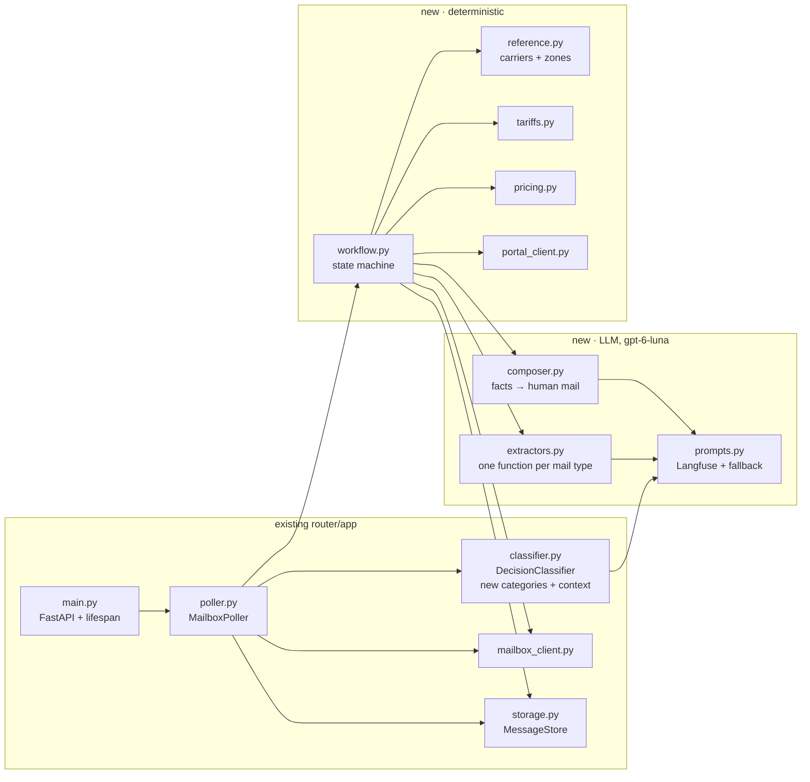
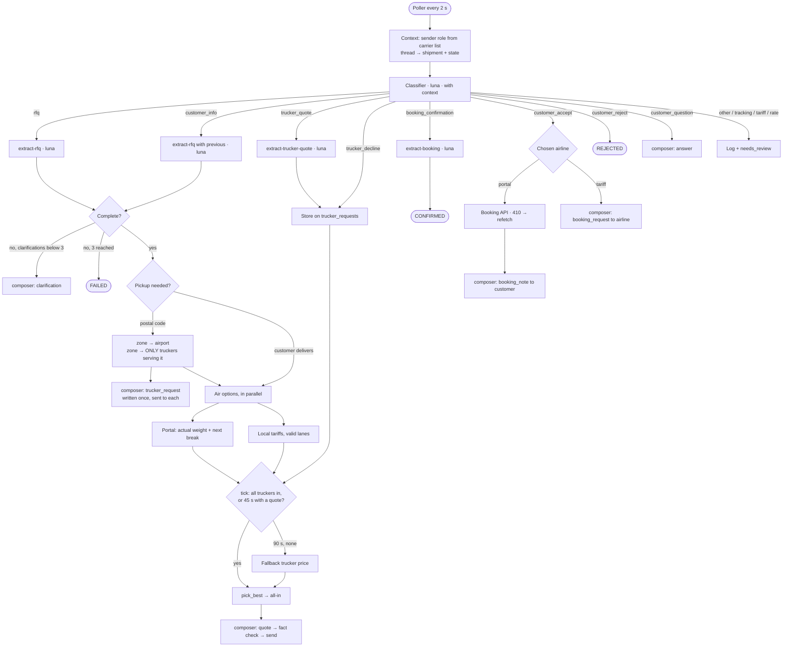
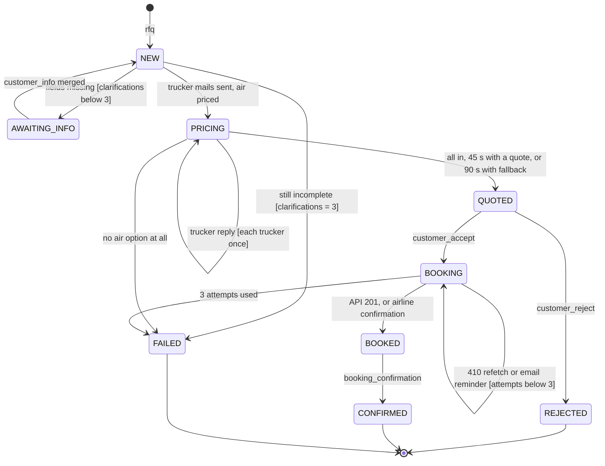

# Implementation plan: quote workflow

Status: **steps 0–8 are implemented on branch `quote-workflow`; steps 9 (live dry run) and 10 (cutover) are open.** What was built, where it differs from this plan, and how it performed is in [implementation.md](implementation.md). Everything extends the existing `router/` app: FastAPI + `MailboxPoller` + `MessageStore` (SQLite) + `DecisionClassifier` + Langfuse. It adds no new framework, scheduler or service. The draft system prompts are in [prompts.md](prompts.md). Every decision behind this plan, with its context, is in [decisions.md](decisions.md). Rules and traps for the implementer are in [HANDOFF.md](HANDOFF.md).

## 1. Decisions

| Topic | Decision |
|---|---|
| Routes | Optional trucker pickup → air freight. **No truck-only routes.** |
| Truckers asked | **Only those whose `serves` contains the request's postal zone** (first 2 digits). Example: 51447 → zone 51 → Maintal, Elbkante, Westfalenroute, Bodenseefracht (4 of 22). |
| Origin airport | `pickup_zones.csv[zone]`, or the airport the customer delivers to |
| Model | **`gpt-6-luna` for every LLM call** (set per task in config) |
| Reading mail | **Two steps:** (1) the **classifier** decides the mail type; (2) a **type-specific extractor** reads only the fields of that type, and only for the types that carry data. Every mail body is read by an LLM; regex or plain parsing is only used for API JSON and CSV data. |
| Writing mail | Every outgoing mail is **written by an LLM** from structured facts. Code checks the numbers; a fixed template is used only if the check fails twice. |
| Prompts | **Langfuse Prompt Management**: one named, versioned prompt per task, with a local fallback file and an eval loop over the real past mails (section 6) |
| Tracing | **Langfuse**: one trace per incoming mail, grouped per shipment as a session (section 7) |
| Margin | `MARGIN_EUR=0` |
| Goal | fastest: transit days → pickup hours → price. cheapest: min air + min trucker. **If not stated: cheapest.** |
| No trucker reply | quote at 90 s with a **fallback trucker price** |
| Local tariffs | Used while valid and while no newer tariff from that airline has arrived. A newer tariff replaces that airline's lanes. |
| Booking | Automatic on acceptance. Portal airline → `POST /portal/bookings`; tariff airline → booking email to the airline. |
| Mail intake | poll every **2 s** (the mailbox has no rate limit; 10/min applies only to `/portal/rates`) |
| Loops | every cycle stops after **3** rounds (section 5) |

## 2. Architecture: what exists and what gets added



What changes in the existing files:

| File | Change |
|---|---|
| `classifier.py` | Stays the first LLM step. It gets **new categories** (section 3) and the **context** as extra input (sender role, the mail of ours this replies to, shipment state). Its prompt lookup moves into `prompts.py`. |
| `schemas.py` | `EmailCategory` gets the new values. New: `ShipmentRequest`, `TruckerQuote`, `BookingConfirmation`, `ComposedMail`, `AirOption`, `ShipmentState`. |
| `config.py` | New settings (section 9); poll interval default 10 → **2 s** |
| `mailbox_client.py` | Add `send()` and `get_message()`, using the same httpx pattern as `poll_messages` |
| `storage.py` | Tables `shipments`, `trucker_requests`, `air_options`, `message_failures` |
| `poller.py` | Context → classify (as today) → `workflow.handle()`; `workflow.tick()` after each poll; retry a failing mail at most 3 times |
| `main.py` | Build `PortalClient` + `Workflow` in `lifespan`; add `GET /shipments` and `GET /shipments/{id}` |

## 3. Mail types: classifier categories and the second call

Every incoming mail goes through the same pipeline:

1. **Context lookup**, with no LLM and only API metadata: the sender's role from the carrier list, and the thread (`in_reply_to` / `references`), which gives the shipment and its state.
2. **Classifier** (`gpt-6-luna`) → one category. The context is part of its input, so a mail from a trucker that replies to our pickup request is easy to place.
3. **Only if the category carries data:** one focused extractor call (`gpt-6-luna`) with a small schema.

| Category | Typical sender | 2nd call | What the workflow does |
|---|---|---|---|
| `rfq` | new customer | `talos-extract-rfq` → `ShipmentRequest` | new shipment |
| `customer_info` | customer, answering our question | `talos-extract-rfq` with the previous request | merge the fields → re-check |
| `trucker_quote` | trucker | `talos-extract-trucker-quote` → `TruckerQuote` | store the price, pickup hours, validity and ref |
| `booking_confirmation` | airline | `talos-extract-booking` → `BookingConfirmation` | CONFIRMED |
| `customer_accept` | customer | **none** | book |
| `customer_reject` | customer | **none** (the mail text is stored) | REJECTED |
| `customer_question` | customer | **none** (the composer reads the question directly) | answer from the shipment facts |
| `trucker_decline` | trucker | **none** | trucker marked as answered |
| `rate_offer` · `tariff_update` · `tracking_request` | airline / desk / customer | **none for now** | log + `needs_review` (action comes later) |
| `other` | anyone | **none** | log + `needs_review`, **no automatic mail** |

Call count per request (one round): 7 classifier calls, plus 5 extractor calls (1 RFQ, 4 trucker quotes), plus 2 composer calls. That's about **14 luna calls**.

So every mail type is understood and logged, including ones we haven't seen yet. The workflow only acts automatically where it has the facts. `other` never triggers a mail.

**Outgoing:** every mail goes through `composer.compose(kind, facts, thread)`. The kinds are `quote`, `trucker_request` (written once, sent to each matching trucker), `clarification`, `booking_note`, `booking_request` and `answer`.

- Written in the thread's language, in a human coordinator tone.
- Code then checks that every price, reference and date appears verbatim. One retry, then the `templates.py` fallback.
- The workflow decides who gets which mail; the LLM only writes the words.

## 4. End-to-end flow



## 5. Shipment state machine (every loop is bounded)



| Cycle | Guard | Stored in |
|---|---|---|
| Clarification (NEW ↔ AWAITING_INFO) | max **3** questions, then FAILED | `shipments.clarifications` |
| Trucker replies (PRICING → PRICING) | each trucker is asked once and recorded once; exit at 45 s or 90 s | `trucker_requests` |
| Booking (BOOKING → BOOKING) | max **3** attempts: API refetch on 410, or email reminder after 10 min | `shipments.booking_attempts` |
| Mail processing retries (**existing poller bug**: a failing mail is retried forever) | max **3**, then skip and move on | `message_failures` |
| Composer fact check | 1 retry, then template | memory |
| Portal 429 | wait `Retry-After`, max **3** times | memory |
| Customer questions in one thread | max **3** automatic answers | `shipments.answers_sent` |
| Duplicate quote | never sent if `quote_message_id` is set | `shipments` |
| Mail ping-pong | no mail goes back to a carrier because of a carrier reply; `other` never triggers a mail | code rule |

## 6. Prompts: precise and iterable

All prompts run on **`gpt-6-luna`** with structured outputs (`chat.completions.parse` + a Pydantic schema, the same pattern as the classifier today).

| Langfuse prompt | Used by | Output schema |
|---|---|---|
| `router-classification` (existing name, **new content**) | `classifier.py` | `ClassificationDecision` (category, confidence, reasoning) |
| `talos-extract-rfq` | `extractors.extract_rfq` | `ShipmentRequest` |
| `talos-extract-trucker-quote` | `extractors.extract_trucker_quote` | `TruckerQuote` |
| `talos-extract-booking` | `extractors.extract_booking` | `BookingConfirmation` |
| `talos-compose-mail` | `composer.compose` | `ComposedMail` (subject, body) |

How the prompts are loaded and used:

- **`prompts.py`** generalises what `classifier.py` already does: `get_prompt(name, **vars) -> (text, lf_prompt)`.
  - It fetches the version with the configured label (`production`) from Langfuse; the SDK caches it for about 60 s.
  - If Langfuse is unreachable it falls back to `router/prompts/<name>.md`.
  - `lf_prompt` is passed as `langfuse_prompt=`, so every generation is linked to its prompt version.
- **The drafts are in [prompts.md](prompts.md)** for review.

The iteration loop:

1. `scripts/build_datasets.py` turns the stored mails (`router.db`) and a hand-labelled `tests/fixtures/labels.json` into Langfuse **datasets**, one per prompt:
   - `talos-classify` (every mail → expected category)
   - `talos-rfq`
   - `talos-trucker-quote`
   - `talos-booking`

   The datasets grow with every round.
2. Edit the prompt in the Langfuse UI, or in `router/prompts/*.md` followed by `scripts/push_prompts.py`. Either way it becomes a new version labelled `staging`.
3. `scripts/eval_prompts.py --prompt <name> --label staging` runs that dataset against the version. It records a Langfuse **dataset run** with a score per item (exact match per field / category) and prints the accuracy next to `production`'s.
4. Promote to `production` when it's at least as good. The running router picks it up.
5. Composer: the check is the fact check pass rate plus a human read of the 6 mail kinds side by side in Langfuse.

Because each prompt has one job, a change to one (e.g. trucker quotes) can't make another worse. Each is measured on its own dataset.

## 7. Langfuse logging

| What | How |
|---|---|
| Trace per incoming mail | `@observe(name="mail")`; trace attributes: `session_id = "shipment-<id>"` (all mails of a shipment in one session), `user_id = sender`, `tags = [sender_role, category, state]`, metadata `message_id` |
| LLM calls | automatic generations via `langfuse.openai` (model, tokens, cost, latency, prompt version) |
| Deterministic steps | spans: `context`, `portal.rate` (request, response, rate-limit remaining), `tariffs.lookup`, `pricing.pick_best` (all options in, chosen option out), `mail.send` (to, subject, body, sent id), `portal.book` |
| Timer work | `tick` creates a trace **only when it changes a state** |
| Outcome scores | `customer_verdict` (1/0) on the quote trace; `fact_check` (pass/fail) on each composer generation; `extraction_complete` on each RFQ |
| Review queue | `needs_review` tag on every `other` / unhandled mail, every classifier confidence below 0.7, and every template fallback |

The exact attribute API in the installed SDK (5.2.0) gets checked in step 0.

## 8. Data model (added to `MessageStore._init_schema`)

```sql
CREATE TABLE IF NOT EXISTS shipments (
  id INTEGER PRIMARY KEY,           -- customer's first mail id = team_reference
  customer TEXT NOT NULL, subject TEXT NOT NULL, language TEXT,
  state TEXT NOT NULL, request_json TEXT NOT NULL,
  goal TEXT, origin_airport TEXT, zone TEXT,
  clarifications INTEGER NOT NULL DEFAULT 0, answers_sent INTEGER NOT NULL DEFAULT 0,
  pricing_started_at TEXT,
  quote_json TEXT, quote_message_id INTEGER, chosen_option_json TEXT,
  booking_ref TEXT, booking_attempts INTEGER NOT NULL DEFAULT 0, last_booking_attempt_at TEXT,
  error TEXT, created_at TEXT NOT NULL, updated_at TEXT NOT NULL
);
CREATE TABLE IF NOT EXISTS trucker_requests (
  out_message_id INTEGER PRIMARY KEY, shipment_id INTEGER NOT NULL, trucker TEXT NOT NULL,
  sent_at TEXT NOT NULL, answered INTEGER NOT NULL DEFAULT 0,
  price_eur REAL, pickup_hours REAL, valid_until TEXT, ref TEXT, reply_message_id INTEGER
);
CREATE TABLE IF NOT EXISTS air_options (
  shipment_id INTEGER NOT NULL, source TEXT NOT NULL,  -- portal | tariff
  airline TEXT NOT NULL, airline_code TEXT, origin TEXT, destination TEXT,
  billed_kg REAL, total_eur REAL NOT NULL, transit_days INTEGER NOT NULL,
  rate_id TEXT, valid_until TEXT, weight_kg REAL, volume_cbm REAL
);
CREATE TABLE IF NOT EXISTS message_failures (message_id INTEGER PRIMARY KEY, attempts INTEGER NOT NULL, last_error TEXT);
```

The existing `processed_messages.category` column stores the new categories, so `GET /messages?category=trucker_quote` keeps working.

## 9. Config additions (`config.py`, all overridable in `.env`)

| Setting | Default |
|---|---|
| `mailbox_poll_interval_seconds` | **2.0** (was 10) |
| `decision_model` / `extract_model` / `compose_model` | `gpt-6-luna` |
| `prompt_label` | `production` (`staging` for evals) |
| `send_enabled` | `False` (dry run: compose and log, but don't send) |
| `mail_signature` | `TALOS Air Freight` (put a person's name here: more human) |
| `margin_eur` | `0.0` |
| `trucker_wait_seconds` / `trucker_fallback_seconds` | 45 / 90 |
| `fallback_truck_eur_per_kg` | 0.28 (until we have stored quotes) |
| `max_clarifications` / `max_booking_attempts` / `max_message_attempts` / `max_answers` | 3 / 3 / 3 / 3 |
| `start_kit_dir` / `tariffs_path` | `../data/start-kit` / `data/tariffs.json` |
| `portal_rate_limit_per_minute` | 10 |

## 10. Module specs

**`prompts.py`**: `get_prompt(name, **vars) -> (compiled_text, lf_prompt | None)`. Uses the Langfuse label, falls back to `router/prompts/<name>.md`, and uses the same `{{var}}` syntax in both places.

**`classifier.py`** (existing, extended)
- `classify(payload, context) -> ClassificationDecision`
- The context (sender role, our previous mail, shipment state) is added to the user message.
- Same `@observe` and the same structured output as today.

**`extractors.py`**: one shared helper `_parse(prompt_name, schema, mail, **vars)`, plus one small function per type:
- `extract_rfq(msg, thread, previous) -> ShipmentRequest`, with `missing_fields(req)` in plain Python. Required: destination, kg, cbm, and (postal code or origin airport). A missing goal means cheapest; we don't ask.
- `extract_trucker_quote(msg, our_request) -> TruckerQuote`: price_eur, pickup_hours, valid_until, ref
- `extract_booking(msg) -> BookingConfirmation`: booking_ref, our_reference, airline, price_eur

**`composer.py`**
- `compose(kind, facts, thread, language) -> ComposedMail`
- `check(kind, facts, mail)`: Python, every item in `facts.must_appear` occurs verbatim
- 1 retry, then `templates.py`

**`templates.py`**: plain f-string fallbacks for the 6 mail kinds. Only used when the fact check fails twice.

**`reference.py`**: cached CSV loaders: `airport_for_zone`, `truckers_for_zone`, `role_for_email`, `airline_email`.

**`scripts/build_tariffs.py` → `data/tariffs.json`** (run once, output committed)
- Turn each file into text (pdftotext, zip XML, txt).
- One luna structured call per file → `list[TariffLane]`. The 2 Danube JPGs go in as images (check luna's vision support in step 2; otherwise use a vision-capable gateway model for this one-off).
- Sanity asserts, a human spot-check of 2 lanes per file, then commit.

**`tariffs.py`**
- `lanes(origin, dest, today)` returns only valid lanes.
- `replace_airline(airline, lanes)` is the hook for tariff mails, which come later.

**`pricing.py`** (pure)
- `chargeable_kg`
- `tariff_total` (minimum on freight only; anti-weight-break)
- `pick_best(air, trucks, goal)`
- `all_in`, `eta`
- `fallback_truck(kg, stored_quotes)`: median €/kg, same zone first

**`portal_client.py`** (same shape as `MailboxClient`; its JSON responses are read directly, with no LLM)
- cached `lanes`, `brackets`
- `rate` (10/min limiter, 429 retry ×3)
- `book` (410 → `RateExpired`)
- `portal_options` (actual weight + next break; the cheaper wins)

**`workflow.py`**
- `context(msg)`
- `handle(msg, decision, ctx)`: dispatch on `decision.category` → extractor if needed → state machine
- `tick()`
- `_on_rfq`, `_send_quote`, `_book`, `_answer`
- Errors are written to `shipments.error` and never re-raised to the poller.

**`poller._process_message`** (small change)

```text
ctx = workflow.context(msg)                            # sender role + thread, no LLM
decision = await classifier.classify(payload, ctx)     # gpt-6-luna, new categories
store.save_processed_message(msg, decision, ...)
await workflow.handle(msg, decision, ctx)              # extractor only if the category carries data
# run_forever: await workflow.tick() after every poll_once()
# ceiling: mails are processed one after another; if 4 trucker replies delay an RFQ noticeably,
#          process a batch with asyncio.gather
```

## 11. Build order (one commit and one test per step)

| # | Step | Done when |
|---|---|---|
| 0 | Config, 2 s poll, mail-retry cap, `prompts.py` (classifier switched over), Langfuse trace attributes | Existing tests green; a failing mail is skipped after 3 attempts; a trace shows its session and tags |
| 1 | `reference.py` | 51447 → CGN and exactly 4 truckers; 61018 → FRA |
| 2 | Tariff build and `tariffs.py` | 10 airlines loaded; spot checks pass; an expired lane is filtered out |
| 3 | `pricing.py` | minimum, surcharges, 966.93 kg billed at 1000, tie-breaks, fallback |
| 4 | `portal_client.py` | the limiter holds back the 11th call; 429 retry; 410 → `RateExpired` |
| 5 | Storage tables | a shipment round-trips through all states |
| 6 | New classifier categories + prompt; `extractors.py` + their prompts; datasets + `eval_prompts.py` | classifier 100% on all past mails; 7/7 RFQs right; all trucker quotes right |
| 7 | `composer` + `templates` fallback | the fact check passes on all 6 kinds; a human reads the samples in Langfuse |
| 8 | `workflow` + wiring | round 4 replay (mocked APIs, recorded LLM answers) → quote contains **€1599.41**, booking called with reference "947" |
| 9 | Live dry run, 2 rounds (`SEND_ENABLED=false`) | logged quote is at least as good as the old process's; traces look complete. **The 10/min rate limit is per team key and shared with the old live process**, so keep dry-run rate reads to a minimum. |
| 10 | Cutover | stop the old process right after a round closes → `SEND_ENABLED=true` |

## 12. Cutover checklist

1. Right after a round closes, stop the old process on the other computer.
2. Set `SEND_ENABLED=true` and restart the router.
3. Watch `GET /shipments`, Langfuse sessions and `GET /v1/board/me`.
4. Roll back by setting `SEND_ENABLED=false`.

## 13. Out of scope for this round

These are recognised by the classifier and logged, but there is no automatic action yet:

- Tracking answers
- Applying tariff-update mails
- Email-only airlines (rate offers)
- Webhook

## Cost note

About 14 `gpt-6-luna` calls per request: 7 classifications, 5 extractions, 2 composed mails. The categories that carry no data (accept, reject, decline, question, other) cost only the classifier call. Langfuse shows the real cost per round.
